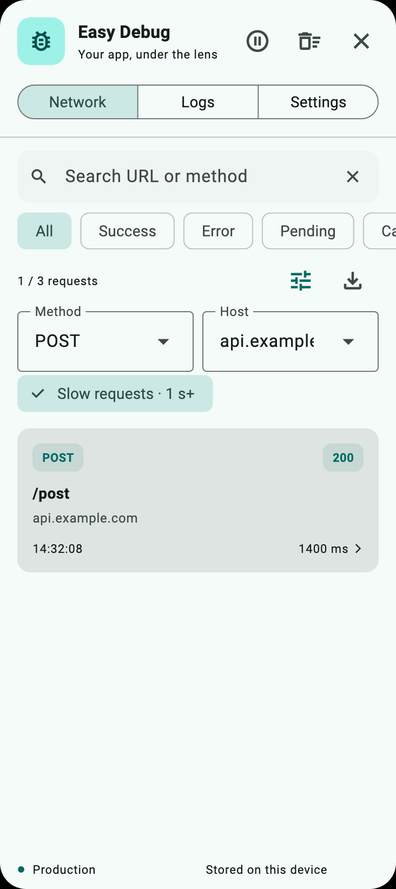
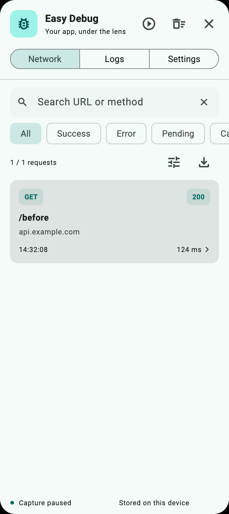

# Easy Debug

An in-app Flutter console for inspecting **Dio**, **http** and application logs.
Open the floating button to see requests, inspect responses, copy details and switch API environments.

<p align="center">
  
  
  
</p>

<p align="center">
  
  
</p>

## Features

- Dio interceptor and an http client wrapper; existing caller responses and errors pass through.
- Request cards, URL/method search, success/error/pending filters and live details.
- Method/host/slow-request filters, a separate cancelled state and query-preserving navigation.
- Filtered HAR export, JSON log export, cURL templates and pause/resume capture.
- Light and dark themes, adaptive panel width, draggable button with screen bounds, keyboard-aware layout.
- Request/response headers and body previews, duration, errors and clipboard copy.
- Bounded network/general logs and body previews; burst notifications are coalesced.
- Environment selection persisted with shared_preferences.
- Capture and UI disabled by default in release builds.

The package implementation is Dart/Flutter. Environment persistence uses the shared_preferences platform plugin. This repository includes Android/iOS example projects; platform support also depends on those dependencies and your host application.

## Installation

Use the Git checkout while evaluating these changes:

```yaml
dependencies:
  easy_debug:
    git:
      url: https://github.com/bobo928/flutter_easy_debug.git
      ref: main
```

Dart 3.10.1 or newer (below 4.0) is required, together with a compatible Flutter SDK.
The verification workflow currently uses Flutter 3.44.7 / Dart 3.12.2.

## Initialize and display the console

```dart
import 'package:easy_debug/easy_debug.dart';
import 'package:flutter/material.dart';

Future<void> main() async {
  WidgetsFlutterBinding.ensureInitialized();
  await EasyDebugManager().init(); // Enables debugPrint capture; idempotent.
  runApp(const MyApp());
}

class MyApp extends StatelessWidget {
  const MyApp({super.key});
  @override
  Widget build(BuildContext context) => MaterialApp(
    builder: (context, child) => EasyDebugWidget(child: child!),
    navigatorObservers: [EasyDebugNavigatorObserver()],
    home: const Scaffold(body: Center(child: Text('My app'))),
  );
}
```

Tap the bug button to open the console. Details stay inside the console and update when a request finishes, without pushing a host application route. Escape or the close button dismisses the console. The observer is needed only if you want automatic clearing when host routes are pushed.

## Connect the clients you actually use

```dart
final dio = Dio()..interceptors.add(EasyDebugDioInterceptor());

final client = EasyDebugHttpClient(http.Client());
final response = await client.get(Uri.parse('https://example.com/data'));
// Close the wrapper when the owning component is disposed.
client.close();
```

Import http as usual: `import 'package:http/http.dart' as http;`.

Requests from other client instances are not captured. Multipart/streamed request bodies are represented by a placeholder. Binary bodies are not rendered as JSON.

The http wrapper retains at most a bounded response prefix, forwards chunks and pause/resume to the source, and records cancellation. Headers are available before body consumption; a response is pending until its stream completes. Duration includes time spent consuming that stream. A stream that is never listened to remains pending.

## Application logs

```dart
debugPrint('A message captured after init()');
EasyDebug.log('Cache refreshed', level: 'INFO');
EasyDebugManager().addGeneralLog('Explicit log entry');
```

Ordinary `print()` and other isolates are not intercepted. Levels are optional. Tap a log card to copy the complete retained message.

Call `EasyDebugManager().shutdown()` to stop recording, clear retained logs and restore the debugPrint hook installed by this package. It does not overwrite a replacement hook installed later by another component. Re-enable configuration and call `init()` to start a new session.

## Filter, pause and export

Use the tune button in Network to combine method, host and slow-request filters. Slow requests are those with a recorded duration of at least one second; pending requests are not treated as slow. Status filters distinguish success, error, pending and cancelled requests. Filters survive opening a detail page and switching console tabs.

The pause button stops **new** network and general-log captures while keeping existing records visible. Responses for requests already recorded continue to update. Resume starts capturing new requests again; pause does not change your app's network behavior.

```dart
final manager = EasyDebugManager();
manager.pauseRecording();
manager.resumeRecording();

const query = NetworkLogQuery(
  method: 'POST',
  host: 'api.example.com',
  status: NetworkLogStatus.error,
  minDurationMs: 1000,
);
final requests = manager.queryNetworkLogs(query);
final har = manager.exportHar(query: query);
final json = manager.exportNetworkJson(query: query);
final curl = requests.isEmpty ? '' : EasyDebugExport.curl(requests.first);
final messages = manager.exportGeneralJson(
  query: const GeneralLogQuery(search: 'retry', severity: GeneralLogSeverity.warning),
);
```

The Network download icon copies only the filtered requests as HAR. The Logs download icon copies filtered messages as JSON, and details provide a cURL copy button. These actions copy text; they never replay a request, upload logs or write files automatically.

Whole-list export buttons use asynchronous encoders so native platforms can encode in a compute isolate. Programmatic callers can use `EasyDebugExport.harAsync(records, config: manager.config)` or `generalJsonAsync(records)`. Flutter Web compute runs on the current event loop; export remains bounded by configured retention/body limits.

HAR output follows the [HAR 1.2 structure](https://github.com/ahmadnassri/har-spec/blob/master/versions/1.2.md). It contains **captured previews**, not original wire payloads. Unknown wire/header sizes are `-1`; content size is the exported text size. Only total elapsed time is available and is placed in the wait field with an explanatory comment; DNS/TLS/send/receive phases and HTTP version are not measured. Extra metadata records pending, cancellation and truncation. No browser-import compatibility claim is made for every HAR consumer.

cURL output is a **POSIX-shell template**. Credentials remain masked, truncated/unavailable bodies are omitted, and stale framing headers are left for cURL to compute. Restore credentials and the full original body before using it for reproduction. JSON/HAR/cURL exports reapply the current capture policy. Plain log messages and error text still require application-specific scrubbing.

## Resource limits and capture policy

```dart
EasyDebugManager().updateConfig(const EasyDebugConfig(
  // Defaults to false in release builds; omit to keep that default.
  enabled: true,
  maxLogCount: 50,
  maxGeneralLogCount: 200,
  maxBodyBytes: 65536,
  maxMessageLength: 4000,
  clearOnNavigation: false,
));
```

Zero record capacity disables retention of that log type. Limits must be non-negative and message length must be positive. Reducing a limit trims retained data. Disabling capture clears records, hides the overlay and bypasses instrumentation for new requests.

- Each request/response body preview is bounded in UTF-8 bytes. Truncated previews are labeled in details and copied output. Large structured bodies are traversed only up to the preview budget, with a nesting-depth limit.
- Incomplete or oversized JSON text is omitted when it cannot be safely parsed within the budget; caller data remains intact.
- General message length is also a UTF-8 byte budget. Headers are limited to 100 entries, with bounded names and values.
- Sensitive headers (Authorization, Cookie, Set-Cookie, Proxy-Authorization, X-API-Key) are masked by default. Common credential keys are masked in structured JSON and URL queries. Customize `sensitiveHeaders` and `sensitiveKeys` if your API uses other names.
- Plain-text bodies, error text and application log messages are not automatically scrubbed. Avoid logging secrets in those channels.
- Reading a notifier returns current values immediately. Immutable list snapshots are generated lazily and cached until the next change; subscriber notifications are batched once per event-loop turn.
- Logs are held in memory only; environment selection is the only persisted data.

Keep debug capture disabled for normal release distribution. If you explicitly enable it, apply the policies appropriate to that build.

## Environment switching

```dart
await EasyDebugManager().init(environments: const [
  AppEnvironment(
    name: 'Production',
    baseUrl: 'https://api.example.com',
    isDefault: true,
  ),
  AppEnvironment(
    name: 'Development',
    baseUrl: 'https://dev.example.com',
  ),
]);
```

The manager restores a saved environment name, then falls back to the default or first entry. Names should be unique. The host must update its clients:

```dart
void onEnvironmentChanged() {
  dio.options.baseUrl = EasyDebugManager().currentBaseUrl;
}

onEnvironmentChanged();
EasyDebugManager().currentEnvNotifier.addListener(onEnvironmentChanged);
// Remove the listener when its owner is disposed.
EasyDebugManager().currentEnvNotifier.removeListener(onEnvironmentChanged);
```

For http, construct new request URIs from the current base URL. Switching environments does not rewrite requests already in flight.

## Development

```sh
flutter pub get
dart format --output=none --set-exit-if-changed lib test example/lib example/test
flutter analyze --no-pub
flutter test --no-pub
cd example
flutter test --no-pub
```

Tests use local adapters and streams, not public API endpoints. They cover retention, redaction, repeated initialization, concurrent HTTP requests, stream errors/cancellation/backpressure, and console interaction at phone and desktop sizes.

See [PERFORMANCE.md](PERFORMANCE.md) for the reproducible ingestion benchmark and its limits.

See [CHANGELOG.md](CHANGELOG.md) for changes and [PUBLISHING.md](PUBLISHING.md) for release checks.

## License

MIT. Original project by JasonBoolean.
